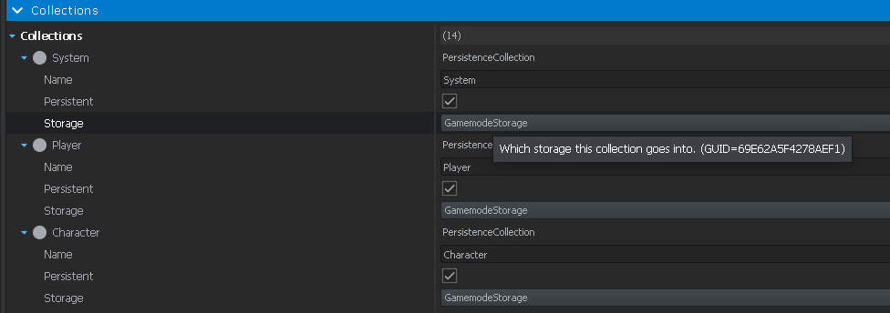
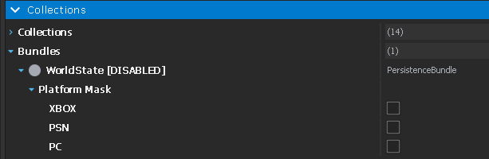
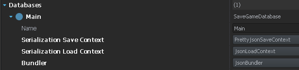

# Persistence configuration

DynamicEconomy features like player wallets/banks and trader rep support Arma Reforger's [vanilla persistence system](https://community.bistudio.com/wiki/Arma_Reforger:Persistence_System).

However in order for the persistence system to save and load them the way you are probably expecting, it needs to be configured with `GamemodeStorage`:

- Open your `PersistenceSystemConfig` if you have a custom one, otherwise create an override of: 
  - `Configs\Systems\Persistence\GameMode\Conflict.conf` for Conflict-based modes
  - `Configs\Systems\Persistence\GameMode\GameMaster.conf` for GameMaster-based modes
- Under `Collections`, override each collection you want included to use `GamemodeStorage`:

- At a very minimum these collections should be set to `GamemodeStorage` for the related things to be fully persistent:
  - `Character` collection contains Character wallets, Trader rep
  - `Player` collection contains Player bank accounts
  - `System` collection contains global economy state like cash:supply exchange rate

If you want a fully persistent "DayZ"-style server you probably want to set **all** collections to using `GamemodeStorage`.

## Other recommendations

### Bundles
Uncheck platform mask under Bundles to make persistence save every entity to a separate file:

### Save Context
Setting the Main Database save/load context and bundler settings to JSON will make it save data to readable JSON files, helpful for debugging. If you combine this with disabled bundling above it will save a separate JSON file per player in the Player collection making it easy to check or edit player bank accounts.

